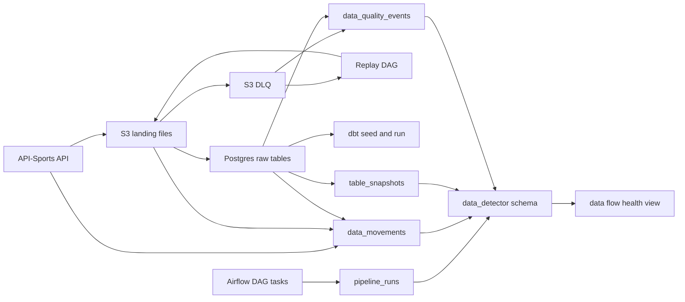

# Data Flow Detector

The `data_detector` schema tracks pipeline execution, movement between storage boundaries, raw table snapshots, and durable data quality events. It is not the source of business truth; it is the audit layer that explains what moved, what changed, and whether stored data is healthy enough to trust.

## Purpose

The pipeline moves data through four main places:

- API-Sports: source API payloads.
- S3 landing and DLQ files: immutable raw JSON payloads and failed-key recovery state.
- Postgres raw tables: structured warehouse input.
- dbt schemas: transformed tables used by analytics/API pages.

The detector records metadata about those flow points so the pipeline can answer:

- Did the expected data arrive?
- Did it load into the expected table?
- How many rows changed?
- What is the latest data timestamp?
- Did a table become stale, shrink unexpectedly, or fail to refresh?
- Is anything stuck in DLQ?

## Bootstrap And dbt Contract

The detector database contract is defined in:

```text
etl/sql/bootstrap_data_detector_schema.sql
```

The bootstrap wrapper is:

```text
etl/src/bootstrap_data_detector_schema.py
```

`bootstrap_raw_fixtures_schema.py` still calls the detector bootstrap after raw fixture schema setup, so existing bootstrap DAG behavior remains intact. The separate SQL file is now the canonical schema contract for detector tables.

dbt reads the detector tables through the source and staging layer:

```text
dbt/football_pipeline/models/staging/data_detector__sources.yml
dbt/football_pipeline/models/staging/stg_data_detector_pipeline_runs.sql
dbt/football_pipeline/models/staging/stg_data_detector_data_movements.sql
dbt/football_pipeline/models/staging/stg_data_detector_table_snapshots.sql
dbt/football_pipeline/models/staging/stg_data_detector_data_quality_events.sql
```

Operational data flow marts live in:

```text
dbt/football_pipeline/models/marts/data_flow/
```

## Detector Tables

### `data_detector.pipeline_runs`

One row per tracked DAG/task execution.

Example:

| pipeline_run_id | run_id | dag_id | task_id | status | started_at | kafka_started_at | data_interval_start | error_message |
|---:|---|---|---|---|---|---|---|---|
| 1 | `scheduled__2026-05-21` | `fixture_update_dag` | `extract_updates` | `success` | `2026-05-21 07:00:00+00` | `2026-05-21 07:00:01+00` | `2026-05-20 00:00:00+00` | `NULL` |
| 2 | `scheduled__2026-05-21` | `fixture_update_dag` | `load_updates` | `success` | `2026-05-21 07:01:13+00` | `2026-05-21 07:01:14+00` | `2026-05-20 00:00:00+00` | `NULL` |
| 3 | `scheduled__2026-05-21` | `fixture_update_dag` | `run_dbt` | `failed` | `2026-05-21 07:04:00+00` | `2026-05-21 07:04:01+00` | `2026-05-20 00:00:00+00` | `relation missing` |

Use it to inspect whether pipeline tasks ran and whether a downstream data issue is caused by an execution failure.

`started_at` is the producer event time computed by the Airflow callback when the task-start event is created. `kafka_started_at` is reserved for the Kafka broker/consumer timestamp when the same event is published through Kafka. The difference between the two is detector ingestion lag.

### `data_detector.data_movements`

One row per movement across storage boundaries.

Example:

| data_movement_id | run_id | dag_id | task_id | movement_type | source_system | source_s3_key | target_schema | target_table | row_count | updated_count | failed_count | status |
|---:|---|---|---|---|---|---|---|---|---:|---:|---:|---|
| 1 | `scheduled__2026-05-21` | `fixture_update_dag` | `extract_updates` | `api_to_s3` | `api_sports` | `incremental/2026-05-21/fixtures.json` | `NULL` | `NULL` | 43 | `NULL` | 0 | `success` |
| 2 | `scheduled__2026-05-21` | `fixture_update_dag` | `load_updates` | `s3_to_raw` | `s3` | `incremental/2026-05-21/fixtures.json` | `raw` | `raw_fixtures` | 43 | 43 | 0 | `success` |
| 3 | `manual__2026-05-21` | `bootstrap_dag` | `load_fixtures` | `s3_to_raw` | `s3` | `full_load/39/2025/2026-05-21/fixtures.json` | `raw` | `raw_fixtures` | 0 | 0 | 1 | `failed` |

Use it to trace a payload from API extraction to S3 and then into Postgres.

Current implementation records:

- `api_to_s3` for bootstrap full-load fixture extraction.
- `api_to_s3` for daily incremental fixture extraction.
- `s3_to_raw` for bootstrap fixture loads.
- `s3_to_raw` for daily incremental fixture updates.
- `raw_correction` for fixture correction updates applied inside `raw.raw_fixtures`.
- `dlq_replay_to_s3` for replaying a failed league-season from API-Sports back to S3.
- `s3_to_raw` for replay loads from landing-zone S3 into raw fixtures.
- failed `api_to_s3` and `s3_to_raw` movements where the task catches and continues or writes to DLQ.

Fixture movements use `kickoff_utc` as the watermark column. `watermark_min` is the earliest kickoff in the payload and `watermark_max` is the latest kickoff in the payload. This describes the match-time coverage of the movement, while `detected_at` describes when the detector observed the movement.

### `data_detector.table_snapshots`

One row per table snapshot after important pipeline steps.

Example:

| table_snapshot_id | run_id | dag_id | table_schema | table_name | row_count | max_updated_at | max_kickoff_utc | snapshot_at |
|---:|---|---|---|---|---:|---|---|---|
| 1 | `scheduled__2026-05-21` | `fixture_update_dag` | `raw` | `raw_fixtures` | 156420 | `2026-05-21 07:01:25+00` | `2026-05-25 19:00:00+00` | `2026-05-21 07:01:26+00` |
| 2 | `scheduled__2026-05-21` | `fixture_update_dag` | `raw` | `raw_league_standings` | 482 | `2026-05-21 07:03:11+00` | `NULL` | `2026-05-21 07:03:12+00` |
| 3 | `scheduled__2026-05-22` | `fixture_update_dag` | `raw` | `raw_fixtures` | 156460 | `2026-05-22 07:01:21+00` | `2026-05-26 20:00:00+00` | `2026-05-22 07:01:22+00` |

Use it to detect stale tables, unexpected row drops, and mismatches between raw and mart freshness.

`raw.raw_fixtures` snapshots use `kickoff_utc` for `max_kickoff_utc` and `updated_at` for warehouse freshness. `raw.raw_league_standings` snapshots use `updated_at` for freshness, leave `max_kickoff_utc = NULL`, and store `leagues_updated` in `details`.

`run_id` makes detector writes idempotent at the pipeline event level. It answers whether a specific DAG/task run was already recorded.

Current implementation records snapshots for:

- `raw.raw_fixtures` after bootstrap fixture loads.
- `raw.raw_fixtures` after incremental update loads.
- `raw.raw_fixtures` after replay loads.
- `raw.raw_league_standings` after standings refresh.

### `data_detector.data_quality_events`

One row per data health issue.

Example:

| data_quality_event_id | run_id | dag_id | task_id | severity | check_name | table_schema | table_name | source_s3_key | status | error_message |
|---:|---|---|---|---|---|---|---|---|---|---|
| 1 | `manual__2026-05-21` | `bootstrap_dag` | `load_fixtures` | `error` | `s3_load_failed` | `raw` | `raw_fixtures` | `full_load/39/2025/2026-05-21/fixtures.json` | `open` | `COPY failed: invalid input syntax` |
| 2 | `scheduled__2026-05-21` | `replay_dag` | `check_dlq` | `warning` | `dlq_not_empty` | `NULL` | `NULL` | `dlq/39/2025/2026-05-21/error.json` | `open` | `1 league-season remains in DLQ` |
| 3 | `scheduled__2026-05-21` | `fixture_update_dag` | `update_standings_task` | `warning` | `standings_stale` | `raw` | `raw_league_standings` | `NULL` | `open` | `standings max(updated_at) is older than expected` |

Use it as the durable alert table. Airflow logs explain what happened in a task; this table records the data health outcome.

## Detector Flow



## Operating Rules

- Record a `pipeline_runs` row for each tracked Airflow task.
- Record a `data_movements` row whenever data crosses a storage boundary.
- Record a `table_snapshots` row only for the raw tables currently monitored by the detector: `raw.raw_fixtures` and `raw.raw_league_standings`.
- Record a `data_quality_events` row for DLQ entries, failed loads, stale data, or unexpected row deltas.
- Keep detector writes best-effort but visible: if detector recording fails, log it without hiding the underlying pipeline result.

## Operational Marts

The detector marts summarize the raw detector tables into API/dashboard-ready operational analytics.

| Mart | Purpose |
|---|---|
| `mart_data_flow_runs` | Latest task status per DAG run and task. |
| `mart_data_flow_movements` | Movement event counts, rows moved, inserted/updated/deleted rows, failed units, and watermarks by movement/source/target/status. |
| `mart_data_flow_table_freshness` | Latest snapshot per monitored table with row count, freshness age, threshold status, and detector stale-event status. |
| `mart_data_flow_quality_events` | Open warning/error/critical quality events. |
| `mart_data_flow_health_summary` | Single-row health answer: current health, failed tasks, stale tables, open quality events, and most recent movement. |

`mart_data_flow_table_freshness.freshness_threshold_exceeded` is informational and only compares the latest table update timestamp to the configured threshold. `mart_data_flow_table_freshness.is_stale` follows open detector quality events, so it stays aligned with the detector's richer stale rules.

`mart_data_flow_health_summary.is_pipeline_healthy` is `true` only when there are no latest failed tasks, no detector-stale tables, and no open warning/error/critical quality events.

## Quality Gate

Run the local detector quality gate before changing detector contracts or DAG wiring:

```bash
scripts/quality_check.sh
```

The gate runs unit tests for `etl/src/data_detector/` and compiles the detector modules plus the tracked Airflow DAG files. It defaults `PROJECT_ROOT` to the current working directory for the compile check.

## Pipeline Run Implementation

Airflow task callbacks write `pipeline_runs` records:

- `on_execute_callback`: computes producer event time and upserts `status='running'` and `started_at`.
- `on_success_callback`: computes producer event time and updates `status='success'` and `finished_at`.
- `on_failure_callback`: computes producer event time and updates `status='failed'`, `finished_at`, and `error_message`.
- `on_skipped_callback`: computes producer event time and updates `status='skipped'` and `finished_at`.

The success callback also preserves an Airflow task instance state of `skipped` when Airflow reports that state through the callback context. This keeps no-op bootstrap days visible as skipped detector rows instead of successful work.

The detector is best-effort. If the detector schema is missing during early bootstrap, the callback logs a warning and leaves the actual pipeline task result unchanged.

When Kafka is added, Airflow should publish the same event payload to a topic such as `ballistics.pipeline.events`. The detector consumer should store the Kafka broker metadata in `kafka_started_at`, `kafka_finished_at`, `kafka_topic`, `kafka_partition`, `kafka_start_offset`, and `kafka_finish_offset`.

The producer contract is documented in `docs/producers/pipeline_run_events.md`.

The movement, snapshot, and quality contracts are documented in:

- `docs/contracts/data_movement_events.md`
- `docs/contracts/table_snapshot_events.md`
- `docs/contracts/data_quality_events.md`

## First Checks to Build

- `dlq_not_empty`: open warning when S3 DLQ contains entries after replay.
- `s3_load_failed`: open error when a fixture landing key fails to load and is sent to DLQ.
- `raw_fixture_stale`: open warning only when current league seasons exist, past unresolved fixtures exist, and `raw.raw_fixtures.max(updated_at)` is older than 26 hours.
- `standings_stale`: open warning when any current league has no standings update within 7 days. Event details include `stale_leagues`.
- `unexpected_row_drop`: error when a key table has a lower row count than its previous successful snapshot without an explicit full-refresh reason.
- `zero_update_payload`: info/warning when incremental extraction produces no updates, depending on fixture calendar context.

## Data Detector Next Todo

- Add table-content fingerprinting only after defining a deterministic hashing contract: exact columns, ordering, filtering, and whether volatile timestamps are included.
- If content fingerprinting is added, store it in `data_detector.table_snapshots` and compute it in `etl/src/data_detector/table_snapshots.py`.
- Build dashboards/API endpoints on top of `mart_data_flow_health_summary` and the four detail marts before adding Kafka.
- Consider Kafka only when the project needs event replay, async consumers, external monitoring, or fan-out beyond Postgres-backed operational analytics.

## Daily Flow Check And Dataset Tracker (2026-10-14)

The tables above record what each task did. The daily flow check answers the end-to-end question: **for each day, did data reach every dataset in the chain, and if not, where did it stop?**

**Dataset tracker** — `etl/src/data_detector/datasets.yml` is the registry of every dataset in the daily chain (API → S3 → raw → dbt → engine → match page): layer, producer DAG/task, upstream datasets and the rule that decides it arrived for a day. It is validated (known upstreams, no cycles, complete check specs) and synced on every check into `data_detector.datasets` and `data_detector.dataset_dependencies`, so lineage is queryable in SQL. CLI:

```text
python -m etl.src.data_detector.datasets validate
python -m etl.src.data_detector.datasets lineage raw.consensus_pool
```

Check types: `pipeline_task` (task succeeded in `pipeline_runs` for the logical date in `metadata.logical_date`), `movement` (a successful `data_movements` row of that type from that day's DAG run), `run_ds_rows` (table has rows for `run_ds`, optional filter) and `derived` (ok when every upstream is ok; used for the API page).

**Daily flow check** — `etl/src/data_detector/daily_flow.py`, scheduled by `airflow/dags/data_flow_check_dag.py` at 09:00 UTC for the same logical date as the 00:00 UTC pipeline runs. Each dataset is `ok`, `failed`, `missing` or `blocked`; a dataset that is not ok because something upstream is not ok is `blocked` and blamed on the furthest-upstream root, so one dbt failure produces one alert, not ten.

- History: `data_detector.daily_flow_checks` (one row per day and dataset).
- Alerts: one open `daily_flow` quality event per root failure (no duplicates on rerun), resolved automatically when that dataset flows again.
- Notifications: `etl/src/data_detector/notify.py` — Slack webhook and/or SMTP email from env (`ALERT_SLACK_WEBHOOK_URL`, `ALERT_EMAIL_TO`, `SMTP_*`); a recovery note when earlier failures clear. With no channel configured the alert is logged and the Airflow task still fails.
- Daily report email: `etl/src/data_detector/email_templates.py` renders one email per day after the 09:00 UTC check (HTML with a plain-text fallback; Slack gets the text). The subject and header follow the day's state — all clear, warnings, failed, recovered — and failures lead the body with the producer, the error and what they block. Below that: datasets ok, fixtures loaded (`s3_to_raw` rows), match pages (`raw.engine_runs.n_fixtures`), consensus pool rows, per-layer status, a 7-day strip from `daily_flow_checks` and upcoming crest coverage. `ALERT_DAILY_REPORT=false` keeps clean days silent; failures, warnings and recoveries always send.

Manual run: `python -m etl.src.data_detector.daily_flow 2026-10-13 [--no-notify]` (exit 1 when anything failed or is missing). When a table joins the daily chain, add it to `datasets.yml`.

### Engine coverage (2026-10-14)

`engine_predict` now carries the same `pipeline_run_*` callbacks as the ETL DAGs, so every engine task (Elo refresh, the three models, quorum, consensus, shortlist validation, forecast init/settle) is recorded in `pipeline_runs`. The registry tracks `engine.refresh_elo`, `raw.model_runs`, `raw.model_picks`, `raw.consensus_pool`, `raw.engine_runs`, `raw.match_analysis`, `engine.daily_shortlists` and `engine.forecast_settlement`. Engine table checks name their producing task(s): when rows are short and a producer failed, the dataset is `failed` with the task's error in the alert, not just `missing`.

### Alert reference

| Check | Severity | Fires when | Resolves when |
|---|---|---|---|
| `daily_flow` | error | A dataset in the registry failed or is missing for the day (root cause only; downstream marked blocked) | That dataset flows on a later check |
| `daily_flow` on `s3.crests.coverage` | warning | A team or league in the next 14 days of fixtures has no crest id (alert names up to 10) | Crests loaded for them |
| `daily_flow` on `s3.crests.reachable` | error | A sample of 5 team + 2 league crest URLs does not answer 200 with an image (bucket policy changed, objects deleted, bucket renamed) | Sample loads again |
| `raw_fixture_stale` | warning | Current seasons have unresolved past fixtures and `raw_fixtures` not updated in 26 h | Next update within the window |
| `standings_stale` | warning | A current league has no standings update in 7 days | Standings refresh |
| `s3_load_failed` | error | A landing file fails to load (bootstrap) and goes to the DLQ | Replay loads it |
| `dlq_not_empty` | warning | DLQ still has entries after the replay DAG | DLQ empty |

Warnings are alerted but do not fail the `data_flow_check` task; errors do. Crest checks are current-state (not tied to the day) and do not block the match page, which falls back to initials. Only `daily_flow` sends notifications; the others are recorded in `data_quality_events` and surface in `mart_data_flow_health_summary`.

## Model watch (email section)

The daily email ends with **Model watch**: shadow checks being tracked before a
decision, never part of pass/fail (`etl/src/data_detector/model_watch.py`).

- **Match Over 1.5 (D120)** — latest weekly refit from
  `engine/eval/watch/match_over_1_5.csv` (written by `engine_calibration.market_watch`):
  claimed vs hit for all models and Dixon–Coles alone, change since the previous refit, drift flag.
- **Big dog Dixon–Coles cross-check (D136)** — `raw.big_dog_watch` holds each published
  Big dog (latest pre-kickoff values) with `dc_win_prob` (DC win chance for the Elo
  favourite) and `dc_confirms` (≥ 65%), written by the consensus run
  (`engine/eval/big_dog_watch.py`). Settled against `raw.engine_head_to_head`; the email
  shows confirmed vs not-confirmed win rates with 90% ranges, a verdict
  (collecting until 100 confirmed settle; FLAG if confirmed favourites do not win more),
  and the Big dogs played that day.
